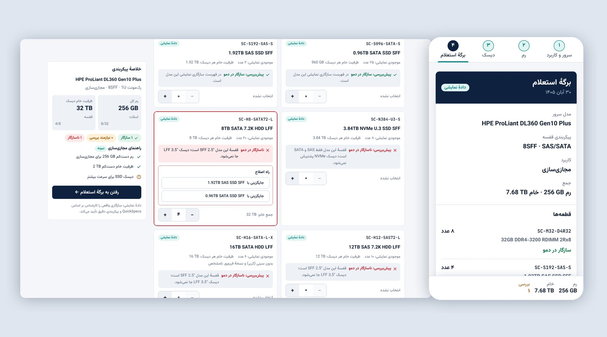

<div align="center">
  <h1>HPE ProLiant RAM &amp; Disk Configurator Demo</h1>
  <p><b>A Persian, right-to-left, phone-first web demo: pick a server model and use case, choose RAM and disks from a demo catalog with live totals and three-state compatibility, fix what doesn't fit, and prepare an inquiry sheet.</b></p>
  <p>Proposal demo by <b>DARIUSH Digital Studio</b> for <b>Server Center</b> · parts, stock and compatibility rules are demo data, not HPE QuickSpecs</p>
  <p>
    <a href="https://dariush-tech.github.io/server-center-config-demo/"><b>Live demo</b></a> ·
    <a href="#demo-flow">Demo flow</a> ·
    <a href="#compatibility-rules">Compatibility rules</a> ·
    <a href="#run-locally">Run locally</a>
  </p>
  <p>
    
    
    
    
    
  </p>
  
</div>

<div dir="rtl">

### خلاصه

دموی پیشنهادی DARIUSH Digital Studio برای سرور سنتر. خریدار یکی از چهار مدل نمونهٔ HPE ProLiant و کاربرد مدنظرش (مجازی‌سازی، ذخیره‌سازی و بکاپ، پایگاه داده یا فایل‌سرور) را انتخاب می‌کند، نوع و تعداد رم و دیسک را از کاتالوگ آزمایشی می‌چیند و رم کل و ظرفیت خام دیسک هم‌زمان به‌روز می‌شود. هر قطعه یکی از وضعیت‌های «سازگار در دمو»، «ناسازگار در دمو» یا «نیازمند بررسی کارشناس» را با دلیل کوتاه می‌گیرد و برای ناسازگاری‌ها راه اصلاح پیشنهاد می‌شود. در برگهٔ استعلام، «کپی خلاصه» و «ثبت استعلام آزمایشی» با کد پیگیری کار می‌کند. «اجرای سناریوی نمونه» کل مسیر را در کمتر از بیست ثانیه نشان می‌دهد. شماره تلفن یا اطلاعات خصوصی خواسته نمی‌شود و استعلام فقط در همین مرورگر ثبت می‌شود.

</div>

## Demo flow

1. **Run the sample scenario.** «اجرای سناریوی نمونه» picks a DL360 Gen10 Plus (8SFF) for virtualisation, adds eight 32GB DDR4-3200 RDIMMs, adds four 8TB LFF disks that the SFF cage can't take, replaces them with 1.92TB SFF SSDs, opens the inquiry sheet and submits it. It runs in about 16 seconds and can be stopped at any time.
2. **Server and use case.** Four sample models: DL360 Gen10 Plus (8SFF), DL380 Gen10 Plus (12LFF), ML350 Gen10 (8SFF) and DL380 Gen11 (8SFF), each with its memory generation, DIMM types, slot count and drive cage.
3. **RAM and disks.** Every catalog card shows a pre-check for the chosen model. Once selected, it shows its status, the reasons and, if incompatible, one-tap fixes (a compatible replacement, fewer units, or removing the row). Total RAM, used slots, raw capacity and used bays update with every change.
4. **Inquiry sheet.** Model, use case, parts, quantities, statuses and every item that needs an expert's review. Submitting is blocked while a definite incompatibility remains; «اصلاح» jumps straight to that part.

## Compatibility rules

All rules live in plain objects at the top of the script and can be edited without a build step.

| Rule | Status |
|---|---|
| Wrong memory generation (DDR4 in a DDR5 server) or unsupported DIMM type (UDIMM in an RDIMM server) | ناسازگار در دمو |
| LFF disk in an SFF cage, or an interface the cage doesn't support (NVMe in a SAS/SATA cage) | ناسازگار در دمو |
| More modules than slots, more disks than bays, or RDIMM mixed with LRDIMM | ناسازگار در دمو |
| Part listed for this model in the demo compatibility list | سازگار در دمو |
| Missing specs (speed, rank, carrier or firmware), part not on the model's list, speed different from the server's | نیازمند بررسی کارشناس |
| SFF disk in an LFF cage (needs a converter), mixed capacities, odd module count across two CPUs, quantity above demo stock | نیازمند بررسی کارشناس |

A part is never shown as compatible when its data is incomplete. Final compatibility is always left to an expert.

## Features

- Model codes and capacities are isolated left-to-right runs inside Persian text, so `32GB DDR4-3200 RDIMM 2Rx8` and `SC-M32-D4R32` stay readable.
- Use-case guidance (sample thresholds for RAM, raw capacity and SSD or HDD) in the summary panel.
- Copy summary as Persian-first lines that stay right-to-left in messaging apps.
- Test inquiries get a code such as `INQ-3101` and are kept in `localStorage` with the current configuration; «بازنشانی دمو» clears both.
- Light and dark themes, a sticky totals bar on phones, keyboard-accessible steps and radio groups.

## Project structure

```
server-center-config-demo/
├── index.html   # markup, styles, demo catalog, rules and scripts (single file, no build step)
└── docs/        # README media
```

## Run locally

```bash
git clone https://github.com/dariush-tech/server-center-config-demo.git
cd server-center-config-demo
python3 -m http.server 8000
# open http://localhost:8000
```

## Notes

- Catalog codes (`SC-…`), stock levels and compatibility lists are invented for this demo and are not HPE part numbers or official compatibility data.
- HPE and ProLiant are trademarks of their respective owners.

---

Design & development: [Dariush Technology](https://github.com/dariush-tech) · DARIUSH Digital Studio
